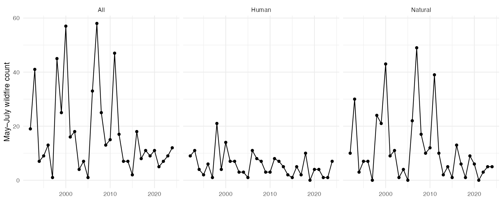

```{r setup, include=FALSE}
knitr::opts_chunk$set(echo = FALSE, warning = FALSE, message = FALSE)
library(ggplot2)
f <- read.csv("Data/processed/anf-fires.csv")
s <- read.csv("Data/processed/seasonal-fires.csv")
m <- jsonlite::fromJSON("outputs/manifest.json")
```

The long-term drought results are in `KBDI.Rmd`; this notebook supplies the
wildfire application. The refreshed seventh-edition FPA FOD archive spans
**`r paste(m$fire_coverage, collapse="–")`** and contains **`r nrow(f)`** ignitions
intersecting the fixed original ANF boundary. All fires are counted once,
including boundary points. Unknown causes remain in All. Zero-fire seasons
are retained throughout the archive's coverage.

## Causes and monthly occurrence

```{r causes}
knitr::kable(as.data.frame(table(Cause = f$nwcg_cause_classification)))
ggplot(f, aes(factor(Month, levels=1:12, labels=month.abb), fill=nwcg_cause_classification)) +
  geom_bar() + theme_minimal() + labs(x=NULL, y="Recorded ignitions", fill="Cause")
```

```{r seasons}

```

## Predrought relationship

```{r scatter}
ggplot(subset(s, eligible), aes(DrynessCm, nFires)) + geom_point() + facet_wrap(~Cause) +
  theme_minimal() + labs(x="April 30 soil moisture deficit (cm)", y="May–July wildfire count")
```

```{r area}
ggplot(s, aes(Year, TAB)) + geom_point() + facet_wrap(~Cause, scales="free_y") +
  theme_minimal() + labs(x=NULL, y="Reported final acres burned")
```

Reported acreage is the final size of each fire igniting within ANF; it is not
the acreage inside the boundary. Counts can change across archive releases,
and reporting changes can produce trends. The forecast does not predict
prescribed burns, ignition locations, individual fire sizes, or consequences.

## Predictor completeness

```{r exclusions}
knitr::kable(subset(s, Cause=="All" & !eligible)[c("Year", "QlmLastDay", "days_since_gap")])
```

Ineligible drought predictors are excluded from modeling, while their recorded
fire counts remain in the descriptive series. No weather imputations are used
in the primary analysis. The gap audit is `outputs/weather-gaps.csv`.
