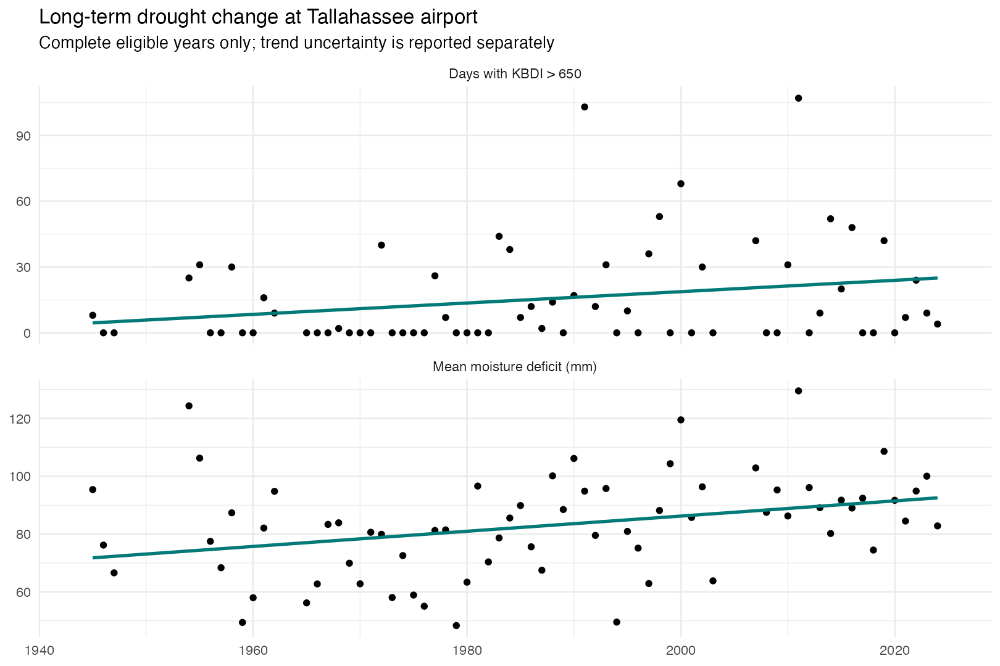
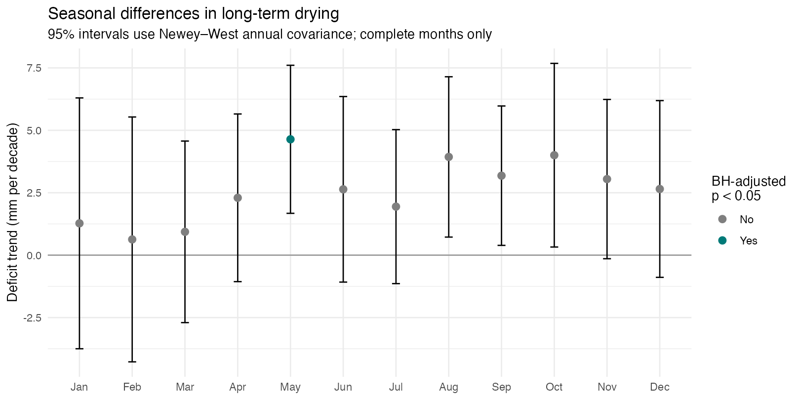
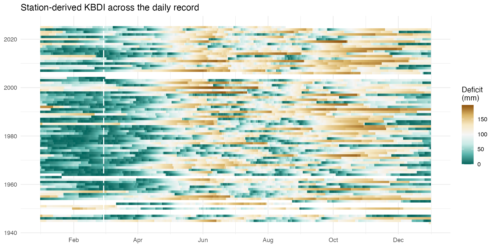
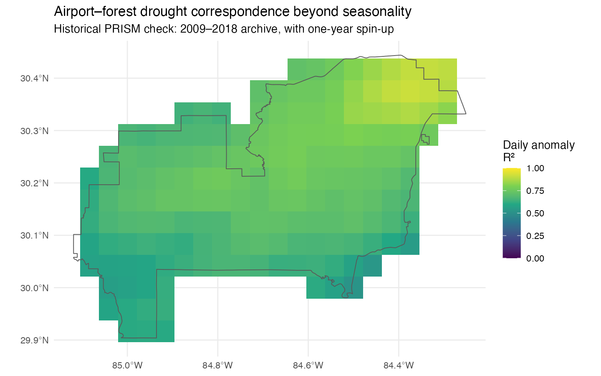

```{r setup, include=FALSE}
knitr::opts_chunk$set(echo = FALSE, warning = FALSE, message = FALSE)
annual <- read.csv("outputs/annual-trends.csv")
monthly <- read.csv("outputs/monthly-trends.csv")
enso <- read.csv("outputs/enso-adjusted-trends.csv")
sensitivity <- read.csv("outputs/kbdi-sensitivity.csv")
manifest <- jsonlite::fromJSON("outputs/climate-manifest.json")
latest <- manifest$last_complete_year
latest_annual <- subset(annual, Endpoint == latest)
latest_monthly <- subset(monthly, Endpoint == latest & Variable == "MeanDeficit")
fmt <- function(x) formatC(x, digits = 2, format = "f")
```

## Main finding: annual drought exposure increased

The updated station record supports increasing annual moisture deficit and more
days above a high KBDI threshold. These are **station-derived drought estimates**,
not direct forest soil-water measurements or an attribution of change to climate
forcing. This report is organized around those results; the wildfire forecast
is an application in `PredictionModel.Rmd`.

```{r annual-results}
a <- latest_annual
for (col in c("Estimate", "SE", "Lower95", "Upper95")) a[[col]] <- a[[col]] * 10
names(a)[names(a) == "Estimate"] <- "ChangePerDecade"
knitr::kable(a[c("Variable", "ChangePerDecade", "Lower95", "Upper95", "PAdjusted", "N", "FirstYear", "LastYear")], digits = 3)
```

MeanDeficit is millimeters; HighDays is days with KBDI greater than 650
(equivalent to 165.1 mm); RainMm is annual rainfall in mm; TmaxC and TminC are
annual daily temperature means in Celsius. Each outcome uses only its complete
eligible years, so effective sample sizes and ending years differ. The table's
LastYear column is the endpoint actually represented in each estimate.

```{r high-days}

```

## Seasonal structure: May has the clearest monthly drying signal

```{r monthly-trends}

t <- latest_monthly
for (col in c("Estimate", "Lower95", "Upper95")) t[[col]] <- t[[col]] * 10
t$Month <- month.abb[t$Month]
knitr::kable(t[c("Month", "Estimate", "Lower95", "Upper95", "PAdjusted", "N", "FirstYear", "LastYear")], digits = 3)
```

Intervals account for serial dependence across annual observations with lag-3
Newey–West covariance and a t reference. Benjamini–Hochberg adjustment covers
12 monthly comparisons for each variable and endpoint. The annual table also
adjusts across its five outcomes. The earlier narrative
of a significant April increase is not supported by this updated specification.
The absolute KBDI threshold and months were inherited from the research
workflow; the pattern across months is exploratory, not a preregistered test.

```{r calendar}

```

## Robustness and alternative explanations

Twenty-seven sensitivity settings vary mean annual rainfall (55, 60, 65 inches),
initial KBDI (0, 400, 800), and spin-up exclusion (180, 365, 730 complete days).
They are assumptions, not estimated optimal settings. The following ranges
summarize unadjusted slope intervals across those settings; they are not a
joint confidence interval.

```{r sensitivity}
ranges <- do.call(rbind, lapply(split(sensitivity, sensitivity$Month), function(d)
  data.frame(Month = month.abb[d$Month[1]], MinimumSlope = min(d$Estimate) * 10,
    MaximumSlope = max(d$Estimate) * 10, MinimumLower95 = min(d$Lower95) * 10,
    MaximumLower95 = max(d$Lower95) * 10)))
knitr::kable(ranges, digits = 3)
```

```{r period-sensitivity}
if (file.exists("outputs/period-covariance-sensitivity.csv")) {
  p <- read.csv("outputs/period-covariance-sensitivity.csv")
  for (col in c("Estimate", "Lower95", "Upper95")) p[[col]] <- p[[col]] * 10
  knitr::kable(subset(p, HACLag == 3), digits = 3)
}
```

The choice of starting year affects trend estimates. These analyses characterize
the observational record; they do not establish that station exposure or
reporting practices are homogeneous over eight decades. Full source records
are retained so station-history and missing-data checks can be extended.

### ENSO adjustment

The broken historical SOI URL has been replaced with NOAA PSL's monthly SOI.
Contemporary SOI is a descriptive covariate; adjustment is not causal attribution.
These models use a shorter common record than the unadjusted trends.

```{r enso}
e <- subset(enso, Month %in% c(4, 5) & Term == "Year")
e$Month <- month.abb[e$Month]
for (col in c("Estimate", "Lower95", "Upper95")) e[[col]] <- e[[col]] * 10
knitr::kable(e[c("Month", "Estimate", "Lower95", "Upper95", "PAdjusted", "N", "FirstYear", "LastYear")], digits = 3)
```

The May slope remains positive in the ENSO-adjusted fit, but its adjusted p-value
must be interpreted alongside the full family of monthly tests. Neither the
rainfall nor the temperature regression establishes a mechanism for drying.

### Correcting the original algorithm

The original net-rain function mishandles storms that cross the 0.2-inch
interception threshold through consecutive small rainfalls. KBDI also needs
net rain subtracted before evaluating the drying increment. The corrected
implementation is bounded to 0–800 and rejects invalid inputs.

```{r legacy-comparison}
if (file.exists("outputs/algorithm-trend-sensitivity.csv")) {
  d <- read.csv("outputs/algorithm-trend-sensitivity.csv")
  for (col in c("Estimate", "Lower95", "Upper95")) d[[col]] <- d[[col]] * 10
  knitr::kable(d, digits = 3)
}
```

Both algorithms in this comparison use the same refreshed observations, the
same gap restarts, and the same eligible years. It isolates implementation
changes from source-data revisions.

## Airport representativeness: a historical spatial check

```{r prism-summary}
if (file.exists("outputs/prism-manifest.json")) {
  p <- jsonlite::fromJSON("outputs/prism-manifest.json")
  cat(sprintf("Across %d intersecting PRISM cells, area-weighted daily R² is %.2f; after removing each location's mean calendar-day seasonal cycle it is %.2f.\n", p$cells, p$raw_r2_area_weighted, p$anomaly_r2_area_weighted))
  
}
```

This recomputes the original **2009–2018** PRISM cache, with one year of spin-up;
it does not extend the gridded observations. Grid cells are weighted by their
intersecting forest area. PRISM and airport estimates are not independent
observations, since PRISM uses station observations. Correlation demonstrates
correspondence, not out-of-sample spatial validation or unbiased forest-wide
measurement. Spatial agreement during this short record does not validate an
80-year forest-wide trend. Treat this as supplementary evidence.

## Data and reproducibility

Daily NOAA GHCN data for USW00093805 include PRCP, TMAX, and TMIN. Native tenths
of SI units are converted explicitly, nonblank quality flags are rejected, and
the calendar is completed. Rainfall is not imputed. KBDI restarts at 400 after
any required-input gap and uses a 365-day spin-up. Only complete months and
years enter the respective trend analyses. This conservative exclusion can
still produce selection effects when missingness is related to drought.

Run `Rscript scripts/run-all.R` from the project root to reproduce the cached
analysis, or add `--refresh` to retrieve current station/fire/SOI sources.
The manifest files and `outputs/session-info.txt` record sources and settings;
`renv.lock` pins package versions. Historical exploratory notebooks remain in
`legacy/` or are listed as peripheral in the README. Their prose and comments
are research context, not instructions to execute.

Sources: [GHCN-Daily documentation](https://www.ncei.noaa.gov/pub/data/ghcn/daily/readme.txt),
[NOAA SOI](https://psl.noaa.gov/data/correlation/soi.data),
[PRISM](https://prism.oregonstate.edu/), and
[FPA FOD seventh edition](https://doi.org/10.2737/RDS-2013-0009.7).
